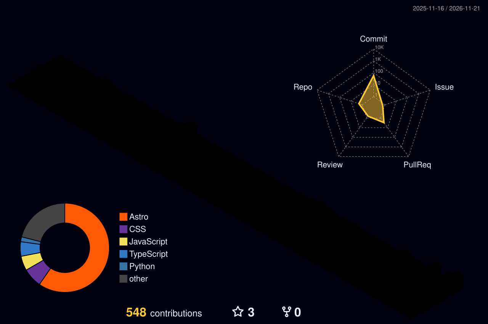

<div align="center">

<!-- Terminal Style Typing Banner -->
<a href="https://github.com/danielmlc">
  
</a>

<p>
  
  <a href="https://github.com/danielmlc?tab=followers">
    
  </a>
</p>

```text
"Writing code is a consolidation of thoughts, a materialization of creativity. Code changes the world!"
```

</div>

---

<!-- ================= ROW 1: TWO-COLUMN CARDS ================= -->
<table width="100%">
<tr>
<td width="50%" valign="top">
<h3 align="center">⚡ SYSTEM_PROFILE</h3>

```yaml
name: danielmlc
role: Full-Stack & SaaS Developer
focus:
  - Low-Code Platforms & DSL Design
  - Developer Tools & Desktop Apps
  - Cloud-Native & Distributed Systems
status: Open Source Contributor
hobbies: [Gaming, Music, Writing, Cycling, Hardware]
```

</td>
<td width="50%" valign="top">
<h3 align="center">🧰 TECH_ARSENAL</h3>
<p align="center">
  <b>Languages & Backend</b><br/>
  
</p>
<p align="center">
  <b>Frontend & Databases</b><br/>
  
  
</p>
<p align="center">
  <b>DevOps & Environment</b><br/>
  
</p>
</td>
</tr>
</table>

---

<!-- ================= ROW 2: PROJECTS & STATS ================= -->
<table width="100%">
<tr>
<td width="50%" valign="top">
<h3 align="center">🚀 FEATURED_PROJECTS</h3>
<ul>
  <li>
    <b>🐟 <a href="https://marlin-md.github.io/marlin-website/">Marlin</a></b><br/>
    <i>Windows Desktop Markdown Editor with native real-time Mermaid diagram rendering.</i>
  </li>
  <br/>
  <li>
    <b>📦 <a href="https://github.com/danielmlc?tab=repositories">More Repositories</a></b><br/>
    <i>Explore my open-source experiments, SaaS tools, and scripts.</i>
  </li>
</ul>
</td>
<td width="50%" valign="top" align="center">
<h3 align="center">📊 TELEMETRY</h3>

</td>
</tr>
</table>

---

<!-- ================= 3D CONTRIBUTION GRAPH ================= -->
<h3 align="center">🏔️ 3D_CONTRIBUTION_TERRAIN</h3>

<div align="center">
  <picture>
    <source media="(prefers-color-scheme: dark)" srcset="https://raw.githubusercontent.com/danielmlc/danielmlc/output/profile-night-rainbow.svg" />
    <source media="(prefers-color-scheme: light)" srcset="https://raw.githubusercontent.com/danielmlc/danielmlc/output/profile-green-animate.svg" />
    
  </picture>
</div>

---

<!-- ================= SNAKE ANIMATION ================= -->
<h3 align="center">🐍 CONTRIBUTION_SNAKE</h3>

<div align="center">
  <picture>
    <source media="(prefers-color-scheme: dark)" srcset="https://raw.githubusercontent.com/danielmlc/danielmlc/output/github-contribution-grid-snake-dark.svg" />
    <source media="(prefers-color-scheme: light)" srcset="https://raw.githubusercontent.com/danielmlc/danielmlc/output/github-contribution-grid-snake.svg" />
    
  </picture>
</div>

---

<!-- ================= FOOTER ================= -->
<div align="center">
  <a href="https://marlin-md.github.io/marlin-website/">
    
  </a>
  <a href="mailto:your-email@example.com">
    
  </a>
</div>
